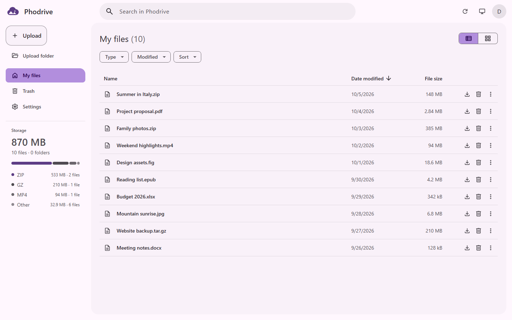
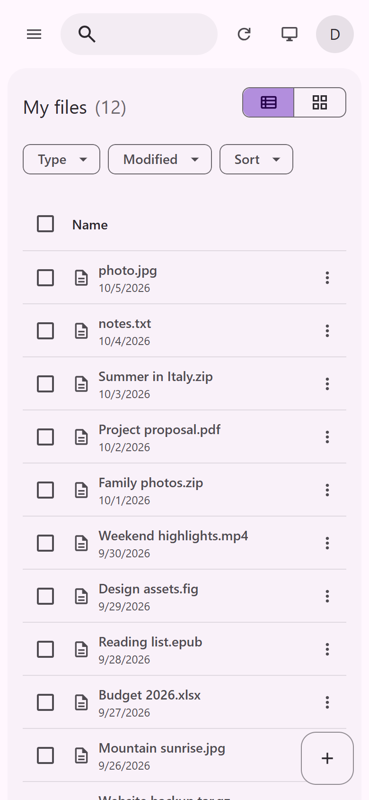
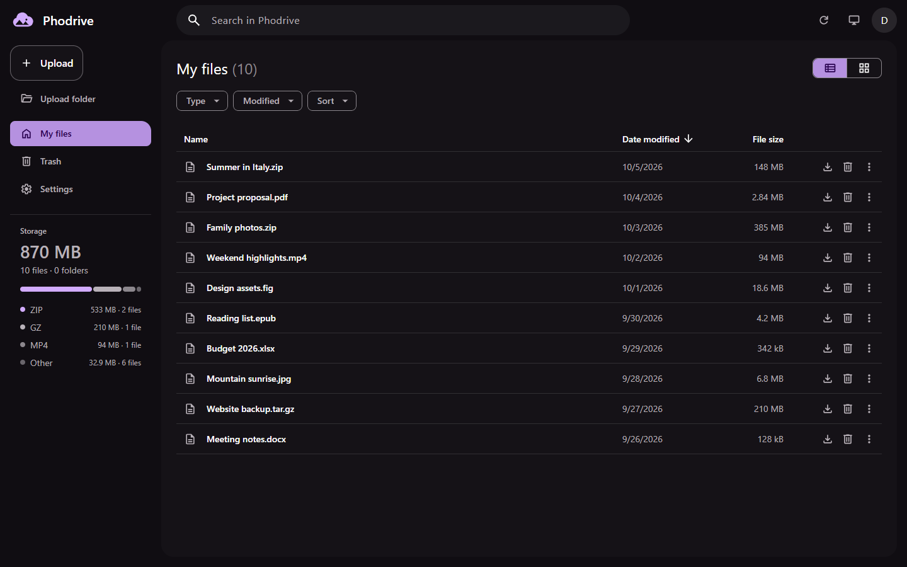
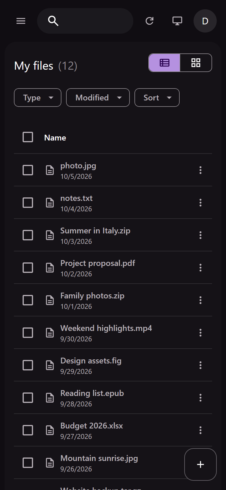
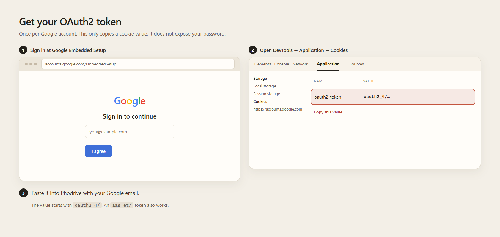

<p align="center">
    
    <h1 align="center">Phodrive</h1>
    <p align="center"><i>Files worth a thousand pixels.</i></p>
</p>

Use Google Photos as a cloud storage provider by spoofing a Pixel XL device to get unlimited storage.

> [!CAUTION]
> Using this project may violate Google's terms or policies and could result in your Google account being restricted or banned.

<table>
    <tr>
        <td></td>
        <td></td>
    </tr>
    <tr>
        <td></td>
        <td></td>
    </tr>
</table>

## Development

Use Node.js 24.21 or newer, or Bun.

```sh
bun install
bun --bun run dev
```

Open `http://127.0.0.1:5173`. With Node.js, use `npm install` and `npm run dev` instead.

The repository uses [Bun workspaces](https://bun.sh/docs/pm/workspaces), also supported by npm. `app/` contains the SvelteKit web app. `core/` is the standalone `@madkarmaa/phodrive-core` library for the file format, Google Photos protocol, and transfers. `cli/` is the `phodrive` command line. Root commands build core before running the app. Run the command line from source with `bun run cli <command>`, for example `bun run cli file list`. See [core usage](./core/README.md) for using the library elsewhere.

Keep environment files at the repository root, for example `.env`.

### Verification

Tests use [Vitest](https://vitest.dev/).

```sh
bun run check
bun run test
bun run build
```

## Deployment

> [!WARNING]
> Do not expose this server to other machines.
>
> The API has no user authentication. Anyone who can reach it can send Google Photos requests through your server and use your machine's network and resources.

### From source

Install dependencies with `bun install`.

To build and run with Node.js:

```sh
bun run build
bun run start
```

To build and serve using Bun:

```sh
bun --bun run build
bun run start:bun
```

Open `http://127.0.0.1:3000` for the production build.

### Docker

```sh
docker run --pull always --rm --init --name phodrive -p 127.0.0.1:3000:3000 ghcr.io/madkarmaa/phodrive:latest
```

Open `http://localhost:3000` or `http://127.0.0.1:3000`. The server derives the upload origin from the request host and port, including a different published port. To override it, pass `-e ORIGIN=http://localhost:3000` with the exact origin used in your browser.

### Deployment defaults

Settings use your saved choice first, then the deployment default, then the built-in default. Phodrive saves a browser preference only when you choose a value. Users without a saved choice receive updated deployment defaults.

| Environment variable                        | Built-in default | Allowed values                                           |
| ------------------------------------------- | ---------------- | -------------------------------------------------------- |
| `PHODRIVE_DEFAULT_REFRESH_INTERVAL_SECONDS` | `60`             | Whole seconds from `0` to `86400`; `0` disables refresh  |
| `PHODRIVE_DEFAULT_CONCURRENT_WORKERS`       | `8`              | Whole numbers from `1` to `32`                           |
| `PHODRIVE_DEFAULT_THEME`                    | `auto`           | `auto`, `light`, `dark`                                  |
| `PHODRIVE_DEFAULT_SORT`                     | `modified-desc`  | `modified-desc`, `modified-asc`, `name-asc`, `name-desc` |

Set these variables in the server environment before starting the app. Missing or invalid values use the built-in defaults. The server publishes the validated settings defaults. For example:

```sh
bunx cross-env PHODRIVE_DEFAULT_REFRESH_INTERVAL_SECONDS=120 PHODRIVE_DEFAULT_CONCURRENT_WORKERS=4 bun run start
```

For Docker, pass the same variables with `-e`, for example `-e PHODRIVE_DEFAULT_CONCURRENT_WORKERS=4`.

### Compression and memory

Compression is off by default. Turn it on per browser in **Settings > Compress uploads**, or for one CLI upload with `--compress`. To make it the CLI default, run `phodrive setting set compression on`. The upload request carries the choice, so the server does not hold global state and two runs can differ.

Changing the setting and uploading the same file again stores a second copy with a different hash. Delete removes every stored chunk for that file, including both copies.

When it is on, the server compresses each chunk with brotli quality 1 if that saves at least 5% of the payload, and stores it raw otherwise. Chunks under 4 KiB stay raw. Text, JSON, logs and source shrink by roughly 75% to 88%. Raw video can shrink by about 88%. JPEG saves about 4% and ZIP about 1%, so both stay raw and the setting is not worth enabling for a library of those.

The single-chunk 195 MB benchmark peaks at about 1,194 MiB with compression and 1,012 MiB with it off, in about 215 ms and 217 ms respectively. The difference is the buffered chunk, which is needed because the BMP header declares the final size before the payload is written. Concurrent chunks multiply that difference. The 182 MiB gap is a floor from a constant-fill fixture; mixed content can use more. Worst case per buffered slot: a chunk that only clears 5% holds about 186 MiB of raw bytes plus roughly twice its compressed output.

Brotli output is deterministic for a fixed Node and brotli version. A Node or brotli upgrade can change the stored bytes and SHA-1, so the same raw chunk may be stored again instead of deduplicating after an upgrade.

## Connect a Google account

1. Open the app at the address shown above for your setup.
2. Sign in at [Google Embedded Setup](https://accounts.google.com/EmbeddedSetup).
3. In developer tools, open Application, then Cookies, then `https://accounts.google.com`. Copy the cookie value starting with `oauth2_4/`.
4. Enter your Google account email and paste the token into Phodrive.



> [!NOTE]
> Your browser stores the credentials. The server uses them for each request and does not save them.

## Folders and storage totals

Drop a folder onto the page, or use **Upload folder**, to keep its relative path. Paths are stored in the uploaded chunk header, so the same folder tree appears from any browser that loads the library. Each folder is also mirrored to a Google Photos album with the same name, which keeps those files grouped in the Photos app too. Album keys are remembered in this browser, per account. If an album create times out after Google accepted it, a retry can create a second album with the same name because the key was never saved.

Folder upload needs a mouse. At 800px or narrower, or without a mouse, the folder button is hidden and dropping folders is unavailable, so upload single files instead.

The navigation sidebar shows how much data the loaded library holds, plus file and folder counts and a breakdown by file type. Totals grow as you press **Load more**, and every upload shows an estimated time remaining next to the progress.

## Command line

The `phodrive` command does everything the web app does without running the server. Each [release](https://github.com/madkarmaa/phodrive/releases/latest) includes executables that don't need Node.js. On Linux or macOS, download yours and make it executable:

```sh
curl -fLo phodrive https://github.com/madkarmaa/phodrive/releases/latest/download/phodrive-linux-x64
chmod +x phodrive
```

Replace `linux-x64` with `linux-arm64`, `darwin-arm64`, or `darwin-x64` for other systems, and add `-musl` on Alpine Linux. On Windows, download `phodrive-windows-x64.exe` or `phodrive-windows-arm64.exe` from the release page. On macOS, download with `curl` instead of a browser, because Gatekeeper blocks apps that a browser downloads unless Apple notarized them. Move the executable to a folder on your `PATH`. `phodrive update` replaces it with the latest release.

The npm package is on GitHub Packages, and installing from there needs a GitHub [personal access token (classic)](https://github.com/settings/tokens) with the `read:packages` scope, even for public packages. Add the registry and your token to `~/.npmrc`:

```ini
@madkarmaa:registry=https://npm.pkg.github.com
//npm.pkg.github.com/:_authToken=YOUR_GITHUB_TOKEN
```

Then install it with `npm install --global @madkarmaa/phodrive-cli`, or run it once with `npx @madkarmaa/phodrive-cli`. To build an executable yourself, run `bun run compile` in a clone of this repository. It writes `cli/build/phodrive`, or `cli/build/phodrive.exe` on Windows.

```sh
phodrive account add you@gmail.com   # asks for the oauth2_4/ token from the steps above
phodrive file list                   # add a search term, --type pdf, --days 30, or --sort name-asc
phodrive file list --folders          # folder paths, file and subfolder counts
phodrive file list --folder photos/2024  # files in one folder
phodrive file upload ./photos        # files and whole folders
phodrive file upload ./photos --compress  # compress this run
phodrive file download report.pdf    # by name or by the ID that file list shows
phodrive file delete report.pdf
phodrive setting set workers 4
phodrive setting set compression on  # default for later uploads
```

Uploading a folder keeps its relative paths, and each folder becomes a same-named Google Photos album, the same as the web app. `phodrive help` lists every command. `phodrive help file upload`, `phodrive file upload --help`, and `phodrive file upload -h` all show the options of one command.

`phodrive` saves accounts and settings in `config.json` in your user configuration folder. On macOS and Linux, only your user can read that file. Set `PHODRIVE_CONFIG` to use another file.

## Attribution

Copyright © 2026 MadKarma (madkarmaa). Phodrive is licensed under the MIT License; see [LICENSE](./LICENSE).

The Google Photos protocol code is based on [xob0t/gotohp](https://github.com/xob0t/gotohp) (MIT).

The Photos library request mask is based on [xob0t/gpmc](https://github.com/xob0t/gpmc) (MIT).

The OAuth2-to-AAS exchange is adapted from [xhyrom/sniff](https://github.com/xhyrom/sniff) (Apache-2.0).

The OAuth2 exchange's DroidGuard compatibility field follows [simon-weber/gpsoauth](https://github.com/simon-weber/gpsoauth) (MIT).
